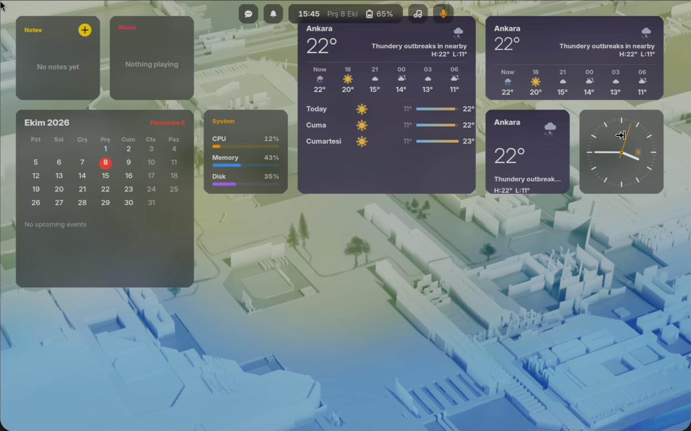

# Glass Widgets for GNOME

Desktop widgets for GNOME Shell in frosted glass, like the macOS desktop: clock, calendar, weather, music, notes, system, batteries and network, snapped to a grid on your wallpaper.

<p align="center"></p>

Part of [himura-desktop](https://github.com/HIMURAw/himura-desktop), a set of GNOME extensions that share one look. Glass Widgets also works fine on its own.

- [Widgets](#widgets)
- [Using it](#using-it)
- [Requirements](#requirements)
- [Install](#install)
- [Settings](#settings)
- [Colour themes](#colour-themes)
- [Troubleshooting](#troubleshooting)
- [Development](#development), [Translating](#translating), [License](#license)

## Widgets

Widgets sit on a grid of square cells. **S** is one cell, **M** is two cells wide, **L** is two by two. Every widget has its own sizes. Clicking a widget (when you are not editing) opens the app it is about.

| Widget | Sizes | Shows | Data comes from | Click opens |
| --- | --- | --- | --- | --- |
| Clock | S, M | S: a watch face with a date window. M: the time in big digits, the date, the week number, and how far through today and this year you are. | The system clock | Clocks |
| Calendar | S, M, L | S: today and the next event. M: today plus the month grid. L: the month grid and the next three events. Days with events get a dot. | GNOME's calendar server, the one behind Online Accounts and Evolution. Events from the current month and the next two weeks are read. | Calendar |
| Weather | S, M, L | S: now. M: now and the next hours. L: also the next three days. The temperature, a drawing of the sky and high/low are shown, and the sky behind the widget follows the weather. | [wttr.in](https://wttr.in), no key needed | Weather |
| Music | S, M | The track, artist and cover with play/pause, previous and next. Paused players are shown as Paused. | Any MPRIS media player on the session bus. It shows the one that played most recently. | The player (clicking the cover raises its window) |
| Notes | S, M, L | Your latest Markdown notes (S: one, M: three, L: six). The **+** button adds a note, clicking a note shows it with Open and Delete (Delete moves it to the trash). | `.md` files in a folder (see [Settings](#settings)) | The notes folder |
| System | S, M | CPU, memory and disk use (M adds uptime and free disk space). | `/proc` and the disk | System Monitor |
| Batteries | S, M | A ring or bar for this computer and for Bluetooth devices that report a level (headphones, mouse, and so on). | UPower | Settings, Power |
| Network | S, M, L | Download and upload speed, the connection's name, the round-trip time to 1.1.1.1, and a "Data saver" mark on metered connections. L adds a longer history graph and Wi-Fi signal strength. Tailscale status (on or off, your Tailscale IP, peers online) shows when the `tailscale` command is installed. | NetworkManager, the interface byte counters, `ping`, `tailscale status` | Settings, Wi-Fi or Network |

Details worth knowing:

- **Weather** refreshes about every 30 minutes (every hour on a metered connection) and retries after 5 minutes when it fails. With no connection the widget says "No weather (offline?)". The place name comes from your setting, or from what wttr.in guesses from your network. Descriptions follow your system language.
- **Notes** only reads `.md` files directly inside the folder (not `README.md`), newest first, and updates live when files change. New notes are saved there as `YYYY-MM-DD HHMM <first words>.md`. The folder is created on the first note if it does not exist. If the folder is missing, the widget says "Folder not found".
- **Calendar** says "No calendars" when no calendar account is set up in GNOME.
- **Music** and **Network** use only local services; Weather is the only widget that goes to the internet.

By default, the first run puts a medium weather, a small calendar, a small clock and a medium music widget on the right side of the screen.

## Using it

- **Right-click** a widget for its size (the current one is ticked), Edit Widgets, and Remove Widget. The weather widget also has Refresh.
- **Edit Widgets** dims the desktop and opens a bar at the bottom of the screen. Press **Add Widgets** to open the gallery: every widget type with its sizes as S, M and L buttons. Press one to add that widget. While editing:
  - **Drag** a widget to move it. It snaps to the grid and never overlaps another one.
  - The **minus** badge on a widget removes it.
  - **Done** ends editing.

  You can also open it from the extension's settings, or from the right-click menu on any widget.

  If a new widget does not fit, you get a notification ("The desktop is full" or "No room for a bigger widget"): remove or move something first.
- **Stepping back.** While an app is in front, widgets dim and grey out and their animations pause; they come back when you return to the desktop. Turn this off with the `dim` setting.
- Widgets live between the wallpaper and your windows, on the primary monitor. Desktop icons (Desktop Icons NG) are drawn *under* the widgets, so place widgets where icons are not.
- Your layout is saved automatically and survives restarts.

## Requirements

- GNOME Shell **50** (see `metadata.json`). Other versions are not tested.
- Optional, for particular widgets: a calendar account (GNOME Online Accounts or Evolution) for Calendar, a media player with MPRIS support for Music, `tailscale` for the Tailscale line in Network.
- To install from source you also need `gettext` (for `msgfmt`) and the GLib command-line tools (for `glib-compile-schemas`). Fedora: `sudo dnf install gettext glib2-devel`. Ubuntu/Debian: `sudo apt install gettext libglib2.0-bin`.

## Install

On Wayland, GNOME only picks up new extensions at login, so **log out and back in once after installing**.

### 1. With the himura-desktop installer

```bash
curl -fsSL https://raw.githubusercontent.com/HIMURAw/himura-desktop/main/install.sh | bash -s -- widgets
```

### 2. From source

```bash
git clone https://github.com/HIMURAw/gnome-glass-widgets.git
cd gnome-glass-widgets
./install.sh
```

`install.sh` compiles the translations and the settings schema, links the folder into `~/.local/share/gnome-shell/extensions/glass-widgets@himuraw` and enables the extension. Because it is a link, `git pull` updates the installed copy (log out and in to load the new code).

### 3. From a release zip

If a release zip (`glass-widgets@himuraw.shell-extension.zip`) is published on the [releases page](https://github.com/HIMURAw/gnome-glass-widgets/releases):

```bash
gnome-extensions install --force glass-widgets@himuraw.shell-extension.zip
gnome-extensions enable glass-widgets@himuraw
```

### Uninstall

```bash
gnome-extensions disable glass-widgets@himuraw
rm -rf ~/.local/share/gnome-shell/extensions/glass-widgets@himuraw
dconf reset -f /org/gnome/shell/extensions/glass-widgets/   # optional: forget the settings and layout
```

## Settings

Open the settings window with **Extensions > Glass Widgets > Settings**, or:

```bash
gnome-extensions prefs glass-widgets@himuraw
```

The window has an **Edit** button (starts editing on the desktop), a **Reset** button (back to the default widgets), the two switches, the weather location and the notes folder (with a folder picker). The same options can be set from a terminal. Point `gsettings` at the extension's schema folder:

```bash
SCHEMAS=~/.local/share/gnome-shell/extensions/glass-widgets@himuraw/schemas
gsettings --schemadir $SCHEMAS set org.gnome.shell.extensions.glass-widgets weather-location 'Berlin'
gsettings --schemadir $SCHEMAS set org.gnome.shell.extensions.glass-widgets notes-folder '~/Documents/Notes'
gsettings --schemadir $SCHEMAS set org.gnome.shell.extensions.glass-widgets dim false
gsettings --schemadir $SCHEMAS reset org.gnome.shell.extensions.glass-widgets layout   # default widgets again
```

| Key | Default | Effect |
| --- | --- | --- |
| `weather-location` | `''` | A city (`Ankara`) or coordinates for the Weather widget. Empty: wttr.in guesses the place from your network. |
| `notes-folder` | `'~/Notes'` | The folder of Markdown notes that the Notes widget shows and adds to. `~` is your home folder. |
| `dim` | `true` | Dim and grey the widgets while an app is in front. |
| `blur` | `true` | Frosted glass: blur the wallpaper behind widgets. Turn it off for slower graphics. |
| `layout` | `''` | Which widgets are where, as JSON: a list of `{id, type, size, col, row}`. Empty means the default set. Edit with the gallery rather than by hand; `reset` brings the defaults back. |
| `editing` | `false` | True while the gallery is open. Normally you do not set it yourself. |

## Colour themes

On its own the widgets are violet-accented and need nothing else. If you also use the **Mor** theme from [himura-desktop](https://github.com/HIMURAw/himura-desktop), its `tema-rengi` command recolours the widgets live: Glass Widgets watches `~/.config/tema/current.json` and swaps its stylesheet when the file changes, with no restart. The theme names it understands are `turkuaz`, `yesil`, `mavi`, `mor`, `cam` and `gri`. If the file is missing or unreadable, you get the original violet.

## Troubleshooting

**Nothing shows up after installing.** Log out and back in; on Wayland a new extension is only loaded at login. Then check that it is enabled: `gnome-extensions list --enabled | grep glass-widgets`.

**The widgets are hidden behind my desktop icons, or the other way round.** Widgets are drawn above Desktop Icons NG. Move them to an empty part of the desktop.

**Weather says "No weather (offline?)".** The widget could not reach wttr.in. Check your connection; it retries every 5 minutes, or right-click and choose Refresh.

**Weather shows the wrong place.** With an empty `weather-location`, the place is guessed from your network address. Set a city name or coordinates in the settings.

**Notes says "Choose a notes folder in the settings" or "Folder not found".** Set `notes-folder` to a folder that exists, or add a first note with the **+** button, which creates the folder.

**Calendar says "No calendars".** Add a calendar in GNOME Settings > Online Accounts, or set one up in Evolution.

**Music says "Nothing playing".** Your player must support MPRIS (most do) and be running.

**A widget will not move or resize.** The grid is full there. Move or remove another widget first.

**Logs.** Follow the shell's messages while you reproduce the problem:

```bash
journalctl -f -o cat /usr/bin/gnome-shell
```

When you report a bug, include your GNOME Shell version (`gnome-shell --version`) and the relevant log lines in an [issue](https://github.com/HIMURAw/gnome-glass-widgets/issues).

## Development

Test in a nested session so you do not have to log out (settings are shared with your real session):

```bash
sudo dnf install mutter-devkit   # Fedora
./build.sh locale                # compiles translations and settings schemas
dbus-run-session gnome-shell --devkit --wayland
```

If a nested session was killed rather than quit, delete `/run/user/$UID/gnome-shell-disable-extensions` if it exists, or your next login starts with extensions off.

- `./build.sh pot` refreshes the translation template after you change strings.
- `./build.sh pack` builds `glass-widgets@himuraw.shell-extension.zip`.
- `npm install && npx eslint .` lints the code.

New widgets live in `widgets/` and are registered in `widgets/index.js`; their data sources are in `sources.js`. Bug reports and pull requests are welcome. Keep changes small and say which GNOME Shell version you tested on.

## Translating

The interface follows your system language. Available: English and Turkish. To add a language, copy `po/glass-widgets@himuraw.pot` to `po/<language>.po`, fill in the `msgstr` lines, run `./build.sh locale` to check that it compiles, and open a pull request.

## License

GNU GPL version 3. See [LICENSE](LICENSE).
