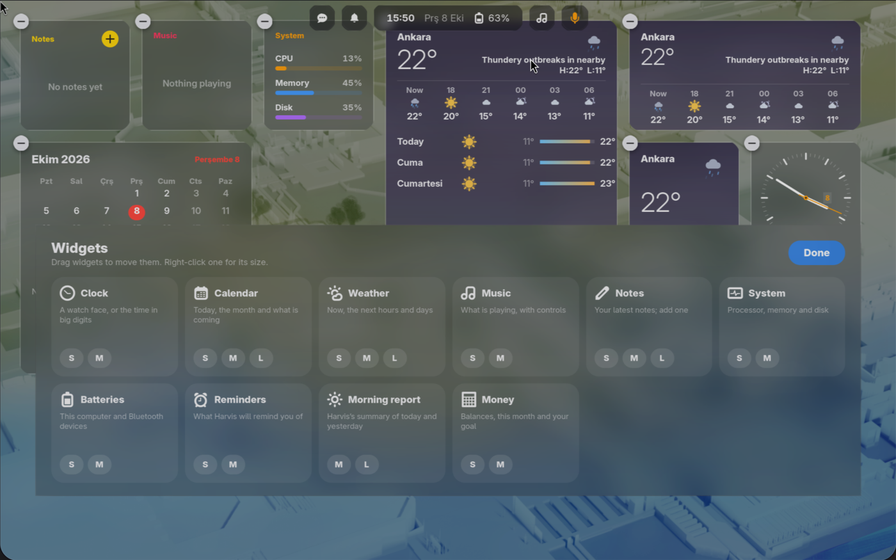

# Glass Widgets for GNOME

Desktop widgets for GNOME in frosted glass, like the macOS desktop. They sit on the
wallpaper below your windows, step back while an app is in front, and snap to a grid.
They share their look with [Dynamic Island](https://github.com/HIMURAw/gnome-dynamic-island)
and [Glass Dock](https://github.com/HIMURAw/gnome-glass-dock).

<p align="center"></p>

## Widgets

| Widget | Sizes | Shows |
| --- | --- | --- |
| Clock | S, M | A watch face with a date window, or the time in big digits with the day and year passing |
| Calendar | S, M, L | Today, the month (days with events dotted) and what is coming, from GNOME's calendars |
| Weather | S, M, L | Now, the next hours and three days, drawn and moving; the sky behind it follows the weather |
| Music | S, M | What is playing in any MPRIS player, with controls; the cover opens the player |
| Notes | S, M, L | Your latest Markdown notes from a folder; + adds one |
| System | S, M | Processor, memory and disk |
| Batteries | S, M | This computer and Bluetooth devices that report a battery (headphones, mouse…) |

## Using it

- **Right-click** a widget for its sizes, Edit Widgets, and Remove Widget.
- **Edit Widgets** dims the desktop and opens the gallery: pick a size to add a widget,
  **drag** widgets to move them (they snap to the grid and never overlap), the **−** badge
  removes one, **Done** or a click on the desktop ends editing.

  

- While an app is in front the widgets grey out and their animations stop; they come back
  when you go to the desktop.
- Desktop icons (gtk4-ding) stay under the widgets, so place widgets where icons are not.

## Settings

Weather location (empty: guessed from the network, via wttr.in), the notes folder, frosted
glass and stepping back behind apps. Start over
puts the default widgets back.

## Install

```bash
git clone https://github.com/HIMURAw/gnome-glass-widgets.git
cd gnome-glass-widgets
./install.sh
```

Then log out and back in (Wayland). GNOME Shell 50.

## License

GPL-3.0-or-later
